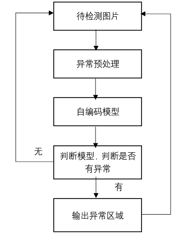
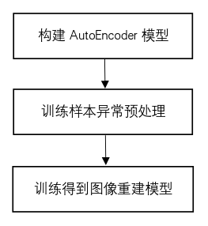
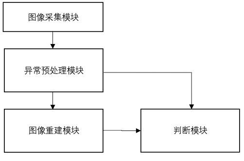

# AI 专利写作方法

## 专利撰写思路

1. 找到一个研究主题，要解决的问题
2. 找idea(核心)

   a. 看论文，要找到一个解决问题的方法，创新点。

   b. 从实际项目中找，比如机械库位检测方法，比如二次规划方法，比如防泊偏方法等等 如果找不到idea，在看论文过程中思路该论文的方法是否可以应用到其它领域，或者该方法结合其它方法 是否可以形成新的idea，或者对该论文方法本身的某个步骤进行改进。

   只要你的专利和现有专利的主权有一个不同处，没有被它所包含，就可以出新的专利。

   举例：

   例1：OCC(occworld)+diffusion+ 端到端思想，将occworld 中的自回归方法改成diffusion方法， 然后端到端输出路径，得到新方法；

   例2：OCC+ 视频生成方法(阿里千问)+ 端到端思想，得到新方法

3. 写主权，查重

   对于方法的核心步骤，写出来后，去专利网站查重，如果有重复，想办法改动方法，让它和现有专利不同  。

4. 形成专利文档文档

   先写主权，再写实施例并同时画图，最后补充其余材料(背景技术详解，)

## 专利文档方法撰写技巧说明

## 1. 写权利要求书

### 1.1 权利要求书的整体布局

一个专利（特殊情况除外）只写一个方法的实施例和一个系统的实施例，权利要求书也只针对方法和系统来写，标准布局为：

- **权利要求1：方法主权**（独立权利要求）
- **权利要求2~n−1：方法副权**（从属权利要求，一般5~7项）
- **权利要求n：系统主权**（独立权利要求）

电子设备、计算机可读存储介质类权项不用自己写，由专利代理人补充，但说明书末尾要保留相应的支撑段落。

副权要自己写初稿，不要全部丢给代理人。原因有三：

1. 副权是主权被审查驳回或被无效时的**逐级退路**，层级设计直接影响专利的稳定性和价值；
2. 写副权的过程就是梳理创新点层级的过程，主权覆盖不住的点可以在副权中兜底；
3. 副权内容直接决定实施例中"其中，所述……"和"进一步地，……"说明段的写法，权利要求书、发明内容、实施例三者同源，一次成型，代理人只做合规润色，不会曲解技术方案。

### 1.2 方法主权的撰写技巧

主权写本发明的主要步骤流程，遵循以下规则：

1. **写方法实际部署运行时的完整流程**，而不是训练流程或优化流程本身。模型的构建、训练、优化过程放副权和实施例中说明。==判定标准为：该步骤是否存在于产品量产运行时的控制或执行链路中；上线前验证、离线训练、回传迭代等环节不属于部署运行流程，不进主权。==
2. **步骤粒度**：拆到"换一个人来实现也必须经过这几步"的粒度，每步一句话，结构为"动作+对象+结果"。
3. **创新点只点名、不展开**。主权中不出现具体实现方式、具体模型结构、具体参数值，否则保护范围会被缩得很小，专利价值大打折扣。具体内容在副权和实施例中说明。
4. **用词一律上位**：能写"图像重建模型"就不写"自编码网络"，能写"差异"就不写"欧式距离"，能写"处理"就不写"3×3高斯模糊"。上位概念的具体候选方案，用副权的"包括但不限于"来枚举。
5. **首句格式统一**："一种××方法，其特征在于，包括以下步骤："。

**主权中允许出现与不允许出现的内容：**

| 允许出现                             | 不允许出现                       |
| ------------------------------------ | -------------------------------- |
| 步骤级流程、动作+对象+结果           | 具体模型选型（AutoEncoder、GAN） |
| 创新点的名称（"异常预处理"）         | 具体参数值（3×3核、t=0.5）       |
| 上位概念（"图像重建模型""判断模型"） | 公式细节、可选方案的枚举清单     |

**不好的示例**

一种基于强化学习和可验证奖励的三维目标检测优化方法，其特征在于，包括以下步骤：

S1. 获取输入数据：获取待处理的带有真值标注的三维场景数据以及针对所述三维场景数据的目标检测指令；所述真值标注至少包含场景中目标的三维边界框和类别属性信息；

S2. 生成候选响应：将所述三维场景数据和目标检测指令输入至一个预设的、支持强化学习策略优化的三维检测模型，所述模型根据当前策略生成至少一个候选响应，其中每个候选响应包含用于描述三维目标检测结果的推理过程和具体的三维目标信息；

S3. 计算可验证奖励：针对每一个候选响应中包含的具体三维目标信息，基于预定义的三维目标检测评估指标，并对照所述输入数据中的真值标注，使用可验证奖励函数计算该候选响应对应的奖励分数；

S4. 模型策略优化：基于所述至少一个候选响应的奖励分数，采用策略优化算法更新所述三维检测模型的策略参数，以提升模型根据目标检测指令在三维场景数据中生成更优三维目标检测结果的能力。

问题分析：这个主权只写了如何训练优化模型，没有写优化完成后方法实际运行的流程。专利应该保护的是最终运行的方法，训练优化方法应在副权和实施例中说明。

**较好的示例**

一种基于异常预处理和图像重建的微小异常检测方法，其特征在于，包括以下步骤：

S1. 采集样本图片，获取训练样本图片以及待检测样本图片；

（备注：本方法具有特殊性质的名词"训练样本图片"，其性质在副权中界定，在实施例中说明。）

S2. 对所述训练样本图片和待检测图片进行异常预处理，抑制图片中的微小异常，得到预处理图片；

（备注：该步骤的创新点"异常预处理"，在副权中枚举可选方案，在实施例中说明。）

S3. 将所述预处理图片输入图像重建模型，得到重建图片；

（备注：该步骤的创新点"图像重建模型"，副权中枚举可选方案并说明其训练过程，实施例中给出具体模型。）

S4. 将所述待检测图片与重建图片输入判断模型，计算待检测图片与重建图片的差异，判断待检测图片是否有异常，如果有异常输出异常所在区域。

（备注：该步骤的创新点"判断模型"，副权中枚举可选方案并细化子步骤，实施例中给出具体实现和参数。）

问题分析：这个主权写的就是方法实际运行时的步骤流程，"异常预处理""图像重建模型""判断模型"三个创新点只点名、不展开，保护范围最大化。

### 1.3 方法副权的撰写技巧

副权对主权逐步加限定，遵循以下规则：

1. **格式固定**："如权利要求X所述的一种××方法，其特征在于，……"。
2. **一条副权只增加一个限定特征**。多个细节拆成多条，不要塞进一条——每条副权都是一级独立的退路，合并会白白损失保护层级。
3. **按主权步骤S1→Sn的顺序依次排列**，便于审查员阅读，也便于自查是否遗漏。
4. **同一步骤内的多个说明按出现顺序排列**：一条权利要求中对同一步骤的多个名词进行说明（性质界定、可选方案枚举、生成方式）时，各说明按其所说明名词在该步骤原文中出现的先后顺序排列，不前后颠倒。
5. **内容只从以下四类中取**：
   - a. **特殊名词的性质界定**：对主权中出现的、具有本方法特殊性质的名词下定义。如"所述训练样本图片为不含有异常的图片"；
   - b. **创新点的可选方案枚举**：用"包括但不限于A、B、C"的句式。这是保护范围最大化的关键写法——列举的方案别人绕过任何一种都侵权，未列举的也被"不限于"兜住。如"所述异常预处理包括但不限于图像模糊处理或者图像去噪或者形态学操作处理或者降低分辨率"；
   - c. **模型的构建与训练流程**：主权中用到模型时，用一条副权说明模型的构建方式和训练方式。如"将所述预处理图片输入图像重建模型之前，还包括：a. 基于自编码模型或可逆神经网络或GAN网络构建一个图像重建模型；b. 用不含有异常的训练样本训练所述图像重建模型"；
   - d. **关键步骤的子步骤细化**：把主权中某个步骤展开为a/b/c子步骤。如"所述步骤S4至少包括：a. 用判断模型计算待检测图片和重建图片每个对应像素的差异；b. 如果差异值超过一定阈值t……；c. 如果有异常，输出异常所在区域"。
6. **引用关系挂成树状**：副权可以引用主权，也可以引用前面的副权；一条副权涉及多个权项的特征时用多项引用，如"如权利要求1或6所述……"。整体形成保护范围阶梯：主权最宽，副权越往后越窄，主权守不住时副权逐级兜底。
7. **副权中仍不写具体参数值**（参数值只出现在实施例中），但**可以写参数的确定规则**。如"所述k的值由实际应用场景决定：如果已知应用场景的异常种类数量，并且训练样本包括正常样本和所有异常类别的样本，则k的值等于异常种类数量加1；如果异常种类数量未知，根据经验人为选定一个k值"。

**完整副权示例**（微小异常检测专利的权2~7，标注每条的类型）：

2、如权利要求1所述的一种基于异常预处理和图像重建的微小异常检测方法，其特征在于，步骤S1所述训练样本图片为不含有异常的图片。

（类型a：名词性质界定，针对S1）

3、如权利要求1所述的一种基于异常预处理和图像重建的微小异常检测方法，其特征在于，步骤S2所述异常预处理包括但不限于图像模糊处理或者图像去噪或者形态学操作处理或者降低分辨率。

（类型b：可选方案枚举，针对S2）

4、如权利要求1所述的一种基于异常预处理和图像重建的微小异常检测方法，其特征在于，步骤S3所述图像重建模型包括但不限于自编码模型、可逆神经网络、GAN网络等。

（类型b：可选方案枚举，针对S3）

5、如权利要求1所述的一种基于异常预处理和图像重建的微小异常检测方法，其特征在于，步骤S3所述将所述预处理图片输入图像重建模型之前，还包括：

a. 基于自编码模型或可逆神经网络或GAN网络构建一个图像重建模型；

b. 用不含有异常的训练样本训练所述图像重建模型，得到最终的图像重建模型。

（类型c：模型训练流程，针对S3）

6、如权利要求1所述的一种基于异常预处理和图像重建的微小异常检测方法，其特征在于，所述步骤S4至少包括：

a. 用判断模型计算待检测图片和重建图片每个对应像素的差异；

b. 如果差异值超过一定阈值t，则判定待检测图片有异常，异常区域为超过阈值的像素区域，否则待检测图片没有异常；

c. 如果有异常，输出异常所在区域。

（类型d：子步骤细化，针对S4）

7、如权利要求1或6所述的判断模型，其特征在于，包括但不限于欧式距离模型。

（类型b+多项引用：枚举判断模型，同时挂到权1和权6上）

### 1.4 系统主权的撰写技巧

系统主权与方法实施例对应，遵循以下规则：

1. **模块与方法步骤一一对应**，每个模块用"用于+动作+对象+结果"的功能性限定描述，不在系统权中重复方法细节。
2. **推荐独立式写法**：不引用方法权利要求。这样即使方法权利要求被无效，系统权利要求仍可能独立成立。
3. 也可用**引用式写法**："一种××系统，应用于权利要求1至n−1任一项所述的××方法，包括：……"。写法省事，但系统权的命运与方法权绑定，方法权被无效时系统权一同失效。
4. 系统副权一般不用自己写，留给代理人补充。==例外：当方法含附带流程（验证、迭代等）时，系统实施例需包含对应功能模块，对应的系统副权需自己撰写。==

**独立式示例**（推荐）：

8、一种基于异常预处理和图像重建的微小异常检测系统，其特征在于，包括：

图像采集模块，用于采集样本图片，得到待检测图片与训练样本图片；

异常预处理模块，用于抑制图片中的微小异常，得到预处理图片；

图像重建模块，用于训练一个图像重建模型，输入预处理图片，得到重建图片；

判断模块，用于计算待检测图片与重建图片的差异，判断待检测图片是否有异常，如果有异常输出异常所在区域。

**引用式示例**：

8、一种基于无监督多模型的异常检测系统，应用于权利要求1-7任意一项所述的一种基于无监督多模型的异常检测方法，包括：

数据采集模块，用于获取数据，得到训练样本和待检测样本；

训练模块，用于训练多个异常检测模型；

部署应用模块，用于判断待检测样本是否有异常或异常类别。

### 1.5 写完后的自查清单

- 主权写的是不是方法**实际运行的流程**，而不是训练/优化流程？
- 主权是否通篇没有具体参数值、具体模型名、公式细节？
- 主权每个步骤是否写清了"输入（来自前步输出或已定义的数据）→处理→输出"？步骤之间的数据衔接是否闭合，有没有凭空出现的参数或数据？
- 主权中的每个创新点，是否都有至少一条副权对它展开？
- 每条副权是否只增加了一个限定特征？是否按S1→Sn顺序排列？
- 每条副权是否都能在实施例中找到对应的"其中，所述……"或"进一步地，……"支撑段？
- 可选方案枚举是否都用了"包括但不限于"句式？
- 系统主权的模块是否与主权步骤一一对应？

---

## 2.写实施例

**2.1 方法的实施例撰写技巧**

**总体结构**

- 首先，将主要权利要求书的步骤全部复制过来。
- 然后，每个步骤按以下四个层次撰写：

  ① **步骤原文**：与权利要求书中的表述保持一致。

  ② **名词与创新点说明，说明与实现成对紧跟**：写完该步骤后，对该步骤中的创新点、该步骤实现的流程、不是业内已有的名词、本方法具有的特殊性质的名词或者方法等进行说明。说明用"其中，所述……是指／用于／包括但不限于……"开头，只做定性说明，不写具体参数和具体型号。**每写完一个说明，立即用"本实施例中，……"写出该说明对象的具体选型或者实现，然后再写下一个说明**；步骤中有多个名词需要说明时，各说明与各实现一一成对，不要把所有说明集中写完之后再统一写实现；**多个说明的排列顺序，按照其说明对象在该步骤原文中出现的先后顺序确定。**如果涉及使用了模型，还需要对该模型的训练流程进行说明；若模型在该步骤中只做推理、不做训练，也要明确说明（例如"参数全程冻结，仅用于特征提取，模型训练在步骤S×中进行"）。

  ③ **方法层流程（第一遍列出）**：若该步骤的实现包含多个子步骤，在创新点说明之后，用"……具体包括以下步骤："引出完整子流程 a、b、c……。这一层只写方法流程，**不出现具体模型型号、参数值、公式**。

  ④ **实施例层流程（第二遍列出）＋逐条具体实现**：用"本实施例中，……流程如**图×**所示，具体如下："总起，**将 a、b、c……各子步骤原样重复一遍，每条子步骤后面紧跟"本实施例中，……"写出该条的具体实现**——具体模型、参数值、公式、阈值，只写与该条子步骤直接相关的内容。流程图与实施例文字必须双向一一对应：附图中出现的每个步骤、每个环节，实施例文字中都有对应的描述；实施例中列出的每个子步骤，也都在附图中有对应节点；对应不上的环节，要么在文字中补充说明，要么从附图中删除，保证审核人员对照附图即可看懂实施例。

**撰写规则**

- **每一步按"输入→处理→输出"书写**：每个步骤（含每个子步骤）的实现描述，必须显式写明本步的输入数据是什么（来自哪个步骤的输出，或来自哪个已定义的数据）、本步对输入数据进行什么处理、本步输出什么结果（供哪个后续步骤使用）。步骤之间的数据衔接必须闭合：全文不出现"凭空出现的参数"，任何被使用的数据都能在前面找到来源。
- **现有技术简单写、创新点详细写**：本领域现有的成熟技术（如标准渲染管线、常规训练技巧、现有成熟算法），只用一两句交代实现过程和作用，不展开原理、不列公式、不用双遍写法；判断标准为"本领域技术人员不经创造性劳动即可实现"。只有创新点步骤、非常规手段，才用完整的四层写法详细展开。
- **涉及模型训练必须写清训练信息**：模型在该步骤中需要训练的，训练流程说明应包括训练集与验证集的规模和构成、样本如何标注、标签是什么、数据从哪里获取（由哪个步骤或哪个设备采集）；不需要特别详细，但要说清楚，保证本领域技术人员能够复现训练过程。训练流程本身属于本发明技术方案的一部分，必须写清楚、不能简写；上一条"现有技术简单写"只简化训练技巧的原理性细节（如反向传播的原理、常规数据增强的原理），不简化本发明训练流程的步骤、数据和标签。
- ==**附带流程独立成节**：与主干步骤S1~Sn不在同一时间线上的辅助流程（模型训练、上线前验证、回传迭代等），不挂在某一步骤之后，以"实施例×附带流程×：××流程"独立成节；每个附带流程同样按"输入→处理→输出"书写，子流程达到4步及以上时用双遍写法，并有独立对应的附图。==
- 权利要求中不用给出具体的参数或者具体模型。但是在本实施例中，对该步骤实现的具体方法、模型、参数等需要给出具体的值。
- ==**禁止虚构参数**：实施例中的参数值、指标必须来自发明人确认的技术方案，不得为追求完整性而虚构；缺少数值时用"预设阈值""由实际应用场景标定"等定性表述，并列入待确认清单交发明人补充。==
- 子流程中出现的特殊名词（例如某个样本集、某个停止条件），**不单独设段定义**，在其对应子步骤的"本实施例中"实现里，用"……的构建方式为……""……即满足……"的方式给出具体构成或者判据。
- **公式只出现在实施例层**。公式只写体现创新点计算逻辑的核心公式；现有成熟算法的标准公式不抄录，改用文字说明（如"采用××方法计算，其为现有方法，此处不再赘述"）；取舍标准为——删掉该公式后本领域技术人员是否还能复现该步骤，还能复现则不写。公式用"按下式给定""计算公式为"引导，公式后面紧跟"其中，"逐个说明符号含义，并给出公式中全部参数的具体取值；能举例时，给出代入具体数值的示例。
- ==**术语与符号全文一致**：不使用"远小于""大概""差不多"等无法界定的模糊表述，需要比较时给出明确阈值；同一概念全文用同一术语（如统一用"三轴尺度"，不与"三维尺度"混用）；|·|仅用于绝对值，‖·‖仅用于范数，正文与附图中的符号完全一致。==
- ==**子流程嵌套编号**：多级嵌套时，一级子流程用a、b、c，二级子流程用1)、2)、3)（或a1、a2），编号层级全文统一，不混用。==
- ==**同类输出的条目化**：当一个步骤涉及同类别的一组输出（如多任务感知输出集合）时，允许采用条目化成对列出，即每条"输出项：定性定义；本实施例中，生成方式"，既满足说明与实现成对紧跟，又保证结构紧凑。==
- 每个步骤，如果有创新的方法或者需要特殊说明的方法，需要用示意图说明的，给出流程示意图，并在实施例中结合图片说明（比如模型训练流程需要给出流程示意图）。**图的引用放在实施例层总起句**（"本实施例中，……流程如图×所示，具体如下："）。

**适用区分**

- 步骤没有子流程，或者子流程不超过3步：用**简单模式**——"其中，所述……"说明后紧跟"本实施例中"实现；或者用"进一步地，S×具体步骤如下：a/b/c"列出子步骤后，再统一写"本实施例中"实现（见示例一）。
- 步骤的子流程达到4步及以上：必须用**双遍写法**（第③④层，第一遍方法层流程＋第二遍逐条配实现），避免实现内容与各子步骤对应关系不清（见示例二）。

**常见错误写法对照**

| 错误写法 | 正确写法 |
|---|---|
| 步骤中的参数、数据凭空出现，没有交代来源；步骤写完不知道输出给谁用 | 每步显式写"输入→处理→输出"，输入须能追溯到前序步骤的输出或已定义的数据，输出须指明供哪个后续步骤使用 |
| 成熟技术与创新点平均用力，现有方法也展开写原理、列公式，篇幅冗长 | 现有成熟方法一两句交代实现和作用；四层写法与公式只留给创新点 |
| 把方法层流程冠以"本实施例中"（流程是方法本身的，不是实施例特有的） | 方法层流程用"进一步地，S×具体步骤如下："或"……具体包括以下步骤："引出 |
| 所有名词说明集中写完，再统一写"本实施例中，其具体实现为：" | 每个说明后紧跟该说明对象的实现，成对出现 |
| 子流程中的特殊名词（如验证样本集、训练停止条件）在使用处没有交代 | 在其对应子步骤的实现里用"构建方式为""即满足"给出 |
| 实现内容写成一大段，与各子步骤对应关系不清 | 双遍写法，第二遍逐条重复子步骤并紧跟该条实现 |
| 公式、具体参数出现在方法层说明中 | 公式与参数值只出现在实施例层 |

**示例一（简单模式：无子流程或短子流程步骤）**

备注：下面的实施例例子中，（示例说明：xxx 示例说明）内容，xxx 部分就是对该步骤的实施例说明。

如图1所示，一种基于异常预处理和图像重建的微小异常检测方法，具体包括以下步骤：

S1. 采集样本图片，获取训练样本图片以及待检测样本图片；

其中，所述训练样本图片为不含有异常的图片；

本实施例中，其具体实现为：在实际的生产制造场景中，用图像采集系统采集大量产品表面样本图片，包含正常样本和异常样本，提取出正常样本作为训练样本。对于训练样本，不需要进行标记。在部署应用时，用图像采集系统采集产品表面样本图片，得到待检测样本。

（示例说明：

步骤S1的后面，对训练样本图片的特殊之处进行说明，具体为：其中，所述训练样本图片为不含有异常的图片。

然后紧跟写S1步骤在本实施例中具体如何实现的——说明与实现成对紧跟。本实施例中，其具体实现为：在实际的生产制造场景中，用图像采集系统采集大量产品表面样本图片，包含正常样本和异常样本，提取出正常样本作为训练样本。对于训练样本，不需要进行标记。在部署应用时，用图像采集系统采集产品表面样本图片，得到待检测样本。

示例说明）

S2. 对所述训练样本图片和待检测图片进行异常预处理，抑制图片中的微小异常，得到预处理图片；

其中，所述异常预处理包括但不限于图像模糊处理或者图像去噪或者形态学操作处理或者降低分辨率

本实施例中，用3x3的高斯核对图像进行模糊处理并用形态学操作中的膨胀腐蚀对图像进一步处理。

（示例说明：

S2步骤，对创新点异常处理进行说明，具体为：其中，所述异常处理包括但不限于图像模糊处理或者图像去噪或者形态学操作处理或者降低分辨率。

然后紧跟写S2步骤在本实施例中具体如何实现的，具体内容如下。本实施例中，用3x3的高斯核对图像进行模糊处理并用形态学操作中的膨胀腐蚀对图像进一步处理。

示例说明）。

S3. 将所述预处理图片输入图像重建模型，得到重建图片；

其中，所述图像重建模型包括但不限于自编码模型、可逆神经网络、GAN网络等；

进一步地，将所述预处理图片输入图像重建模型之前，还包括：

a. 基于自编码模型或可逆神经网络或GAN网络构建一个图像重建模型；

b. 用不含有异常的训练样本训练所述图像重建模型，得到最终的图像重建模型。

本实施例中，图像重建模型采用AutoEncoder模型。训练步骤如图2所示：

1. 构建一个AutoEncoder模型；
2. 将训练样本通过图像高斯模糊处理并用形态学操作中的膨胀腐蚀对图像进一步处理，抑制微小异常，得到预处理训练样本；
3. 利用预处理训练样本训练AutoEncoder，得到最终的图像重建模型。

进一步的，将待检测得到的预处理图片输入图像重建模型，得到重建图片。

（示例说明：

步骤S3，对创新点重建模型进行说明，具体为：其中，所述图像重建模型包括但不限于自编码模型、可逆神经网络、GAN网络等。

S3步骤中，使用了一个重建模型，涉及使用了模型，还需要对训练模型的流程进行说明。这里不需要写具体方法、模型、参数等，具体为：进一步地，将所述预处理图片输入图像重建模型之前，还包括：a、b。

然后，写S3步骤在本实施例中具体如何实现的，在如何实现中才写具体用的什么模型和参数，具体内容如下：本实施例中，图像重建模型采用AutoEncoder模型。训练步骤如图2所示：1、2、3。

示例说明）。

S4. 将所述待检测图片与重建图片输入判断模型，计算待检测图片与重建图片的差异，判断待检测图片是否有异常，如果有异常输出异常所在区域。

进一步的，所述的判断模型包括但不限于欧式距离模型。

进一步地，S4具体步骤如下：

a. 用判断模型计算待检测图片和重建图片每个对应像素的差异；

b. 如果差异值超过一定阈值t，则判定待检测图片有异常，异常区域为超过阈值的像素区域，否则待检测图片没有异常；

c. 如果有异常，输出异常所在区域；

本实施例中，t的值由如下方法确定：将训练样本输入图像重建模型，从t=0.5开始，每次增加0.5，一直到t=0.95。t的不同取值将对应不同的准确率，取准确率最高的那个t值作为t的最后取值。

本实施例中，判断模型采用欧式距离模型。异常判定的具体步骤如下：

1. 计算待检测图片和重建图片每个对应像素的欧式距离；
2. 判断所有像素的欧式距离是否超过t，如果超过t则判定待检测图片有异常，异常区域即像素所在区域，否则没有异常；
3. 当出现异常时，输出该像素所在的区域。

（示例说明：

步骤S4，对创新点判断模型进行说明，具体为：进一步的，所述的判断模型包括但不限于欧式距离模型。

对S4实现步骤具体说明，具体为：进一步地，S4具体步骤如下：a、b、c。

然后，写S4步骤在本实施例中具体如何实现的，在如何实现中才写具体用的什么模型和参数。

示例说明）

**示例二（双遍写法：子流程达到4步及以上的步骤）**

备注：本示例取自"一种基于预训练视觉基础模型预标注与自适应伪标签优化的水下声纳点云三维目标检测模型训练及检测方法"的步骤S5，该步骤的闭环迭代训练流程含a~g共7个子步骤。

S5. 利用所述优化三维伪标签集合训练三维目标检测模型，并基于模型训练反馈对伪标签和/或训练样本进行迭代调整，得到训练完成的三维目标检测模型。

其中，所述三维目标检测模型用于从水下声纳三维点云数据或者水下多模态场景数据中检测水下目标，并输出目标类别和三维位置信息。

本实施例中，三维目标检测模型采用稀疏卷积三维目标检测网络Sparse4D。

所述基于模型训练反馈对伪标签和/或训练样本进行迭代调整，是指在模型训练过程中，根据模型检测性能、类别学习不足程度、样本特征分布情况和模型阶段性表现，对伪标签质量、训练样本采样权重以及模型参数进行闭环调整。闭环迭代训练流程具体包括以下步骤：

a. 利用当前优化三维伪标签集合训练三维目标检测模型；

b. 在每个训练周期结束后，在独立的验证样本集上对三维目标检测模型进行性能评估；

c. 根据模型性能评估结果确定不同类别和不同场景的训练不足程度；

d. 根据训练不足程度调整下一训练周期的样本采样权重；

e. 利用预训练视觉基础模型提取未标注训练样本的视觉语义特征，并根据特征空间分布提高低密度区域样本的采样权重；

f. 在预设训练轮次保存模型参数副本，根据模型参数副本之间的特征表示一致性进行模型聚合；

g. 重复上述训练与反馈调整过程，直到满足训练停止条件，得到最终三维目标检测模型。

本实施例中，闭环迭代训练流程如**图4**所示，具体如下：

a. 利用当前优化三维伪标签集合训练三维目标检测模型；

本实施例中，将声纳三维点云体素化，体素尺寸设置为 $0.1\text{m} \times 0.1\text{m} \times 0.1\text{m}$；模型训练批量大小设置为128；初始学习率设置为0.001；优化器采用AdamW；训练轮次设置为80轮。

b. 在每个训练周期结束后，在独立的验证样本集上对三维目标检测模型进行性能评估；

本实施例中，验证样本集的构建方式为：从采集的水下多模态场景样本中抽取5000组样本，由人工标注目标类别和三维边界框，构成验证样本集；验证样本集与未标注训练样本不重叠，仅用于模型性能评估，不参与模型训练。

c. 根据模型性能评估结果确定不同类别和不同场景的训练不足程度；

本实施例中，在每10个训练轮次结束后，使用验证样本集评估模型性能，得到不同类别目标的平均精度（Average Precision，AP），具体采用三维交并比阈值为0.25时的AP指标（3D AP@0.25）。若某一类别目标的AP低于所有类别平均AP的 $80\%$，则认为该类别训练不足；场景训练不足的判定方式相同。

d. 根据训练不足程度调整下一训练周期的样本采样权重；

本实施例中，下一训练周期的样本采样权重按下式给定：$w_c=1+\max(0,\;1-AP_c/\overline{AP})$。其中，$w_c$ 表示类别 $c$ 相关样本在下一训练周期的采样权重，$AP_c$ 表示类别 $c$ 的AP，$\overline{AP}$ 表示所有类别的平均AP。例如，当 $AP_c/\overline{AP}=0.8$ 时，$w_c=1.2$；采样权重上限不超过2。

e. 利用预训练视觉基础模型提取未标注训练样本的视觉语义特征，并根据特征空间分布提高低密度区域样本的采样权重；

本实施例中，采用密度聚类方法将样本划分为多个特征簇，若某一特征簇的样本数量占总样本数量的比例低于 $3\%$，则将该特征簇标记为低密度特征区域，并在下一训练周期中将该区域对应样本的采样权重提高至原来的2倍。

f. 在预设训练轮次保存模型参数副本，根据模型参数副本之间的特征表示一致性进行模型聚合；

本实施例中，在第40轮、第60轮和第80轮分别保存三维目标检测模型参数副本，根据各副本在验证样本上的特征表示一致性得分，采用softmax形式确定聚合权重（温度系数取0.1），对多个模型参数副本进行加权平均，得到最终训练完成的三维目标检测模型。

g. 重复上述训练与反馈调整过程，直到满足训练停止条件，得到最终三维目标检测模型。

本实施例中，训练轮次设置为80轮，训练轮次达到80轮即满足训练停止条件。

（示例说明：

① 步骤原文后，先对名词"三维目标检测模型"定性说明（其中，所述……用于……），**紧跟**"本实施例中"给出具体选型Sparse4D——说明与实现成对出现，不分离；

② 创新点"基于模型训练反馈的迭代调整"用"是指……"说明之后，**第一遍**列出a~g方法层流程，此层无参数、无公式；

③ "本实施例中，闭环迭代训练流程如图4所示，具体如下："**第二遍**逐条重复a~g，每条后面紧跟该条的具体实现（体素尺寸、批量大小、学习率、训练轮次、公式、阈值）；

④ 特殊名词"验证样本集"不单独设段定义，在步骤b的实现里用"……的构建方式为……"给出（5000组、人工标注、不重叠、仅评估不参与训练）；

⑤ "训练停止条件"在步骤g的实现里给出具体判据（训练轮次达到80轮即满足）；

⑥ 公式只出现在实施例层（如步骤d的采样权重公式），公式后紧跟"其中，"逐符号说明，并给出代入数值的示例（$AP_c/\overline{AP}=0.8$ 时 $w_c=1.2$）。

示例说明）

**2.2 系统的实施例撰写技巧**

- 首先，将系统权利要求的模块列表复制过来作为开头："如图×所示，一种……系统，包括：模块1、模块2……模块N。"模块由方法步骤映射而来：可以一个步骤对应一个模块，也可以多个步骤合并为一个功能阶段模块（如训练模块、部署应用模块）。
- 然后，每个模块按三段式撰写：

  ① **功能句**："××模块，用于……"——功能描述与方法权利要求中对应步骤的表述一致（把步骤的动作写成模块的用途）。

  ② **子模块划分**（系统较复杂时）："本实施例中，××模块包括……子模块／单元"，每个子模块一句"用于……"，子模块与方法步骤的子流程（a~g或1~5）一一对应。

  ③ **实现句**："本实施例中，具体实现为：……"——概括自方法实施例对应步骤的"本实施例中"实现，给出关键模型与关键参数，不重复公式推导与完整流程；需要引用详细实现时注明"具体见实施例一步骤S×"。

- **不新增技术内容**：系统实施例中的所有实现细节必须已在方法实施例中出现过，系统实施例是方法实施例的模块化映射与概括重述。
- ==**附带流程的模块落点**：方法实施例中的附带流程（验证、持续学习等）应在系统实施例中以"进一步地，所述系统还包括××模块"的从属模块形式给出落点，实现句注明"具体见实施例×附带流程×"，并对应一条系统副权；否则附带流程的附图内容在系统实施例中悬空。==
- **数据流说明**：模块输出供哪些模块使用，用一句"××模块输出的……用于××模块和××模块"说明，与系统结构示意图中的连接关系对应。
- **图文对应**：系统结构示意图（图×）中的模块、子模块须与文字一一对应。
- **结尾**：系统实施例末尾可用"综上可知，本发明提出的……方法及系统的有益效果是：……"总结。

**示例**

备注：本示例取自"一种基于异常预处理和图像重建的微小异常检测系统"的实施例二，该系统4个模块与方法S1~S4一一对应。

如图3所示，一种基于异常预处理和图像重建的微小异常检测系统，包括：图像采集模块、异常预处理模块、图像重建模块、判断模块。

图像采集模块，用于采集样本图片，得到待检测图片与训练样本图片；

本实施例中，具体实现为：用图像采集系统采集大量样本图片，包含正常样本和异常样本，提取出正常样本作为训练样本。对于训练样本，不需要进行标记。在部署应用时，用图像采集系统采集图片，得到待检测样本。

异常预处理模块，用于抑制图片中的微小异常，得到预处理图片；

本实施例中，具体实现为：用3x3的高斯核对图像进行模糊处理并用形态学操作中的膨胀腐蚀对图像进一步处理。

图像重建模块，用于训练一个图像重建模型，输入预处理图片，得到重建图片；

本实施例中，具体实现为：对经过预处理的训练样本训练AutoEncoder模型，得到图像重建模型。将待检测图片输入图像重建模型，得到重建图片。

判断模块，用于计算待检测图片与重建图片的差异，判断待检测图片是否有异常，如果有异常输出异常所在区域。

本实施例中，具体实现为：计算待检测图片和重建图片之间对应像素的欧式距离，判断距离是否有超过阈值t，如果有超过阈值t的像素则待检测图片有异常，并输出异常位置，否则待检测图片没有异常。

（示例说明：

① 模块与方法步骤一一对应：图像采集模块对应S1、异常预处理模块对应S2、图像重建模块对应S3、判断模块对应S4；

② 每个模块两段式：先"××模块，用于……"功能句（与方法主权对应步骤的表述一致），再"本实施例中，具体实现为：……"实现句（概括自方法实施例对应步骤的实现，不重复公式与细节）；

③ 系统实施例不新增技术内容，所有实现细节均已出现在方法实施例中。

示例说明）

## 3.附图说明

**撰写技巧**

**1. 画哪些图（图的规划）**

- 方法整体流程图 1 张，对应主权 S1~SN；
- 每个含创新子流程的步骤各 1 张子流程图（如预标注流程、训练流程、部署流程），图的节点与该步骤实施例中的子步骤 a~g 一一对应；
- 系统结构示意图 1 张，模块、子模块与系统实施例文字一一对应；
- 有硬件部署时，再画 1 张集成结构图（设备、传感器、计算单元、通信关系）。

**2. 怎么画（绘制方法）**

- 先用文字或 mermaid 列出图的节点与连接关系，确认与实施例文字一一对应后，再用绘图工具正式绘制；
- **先对齐、再连线**：同一流程主线上的框严格对齐成一条线（纵向流程中心对齐成一条纵线，横向流程同高对齐成一条横线），使主干连线全部是直线、不转弯；只有源框与目标框不同高也不同纵线时，连线才转弯，且只转一次直角弯；
- **同列框的中心线必须严格同横坐标**：有直线连接关系的上下两个框，中心横坐标必须完全相等——差1px都会在竖线中途形成一个小台阶，肉眼可见地“弯”；若有多个框竖直指向同一个目标框，用**加宽目标框**的方式让各源框的中心线正对目标框顶边上的各自入框点（入框点用 entryX 的小数取值精确定在源框中心线上），保证每条竖线都笔直、不转弯；
- 绘制规范：黑白线条图，不用彩色、灰度和照片；矩形表示步骤或模块，菱形表示判断分支，箭头表示数据或流程方向，分支条件（是/否、有/无）标注在箭头旁；图中文字一律用中文；
- 工具：PPT、Visio、draw.io（免费）均可。工具参考：论文中卷积神经网络常见的示意图用什么软件来画比较容易？ - 路导的回答 - 知乎
  https://www.zhihu.com/question/40698990/answer/116724362377

**3. 连线与文字（防穿框、防交叉、防遮挡）**

- **每条连线必须显式指定出框点和入框点，禁止依赖自动布线**。只连接两个框而不指定锚点时，绘图工具的自动布线会从框侧边出线、横穿相邻方框。操作方法：draw.io 中把线端拖到目标框指定边的中点，待出现锚点标记后吸附（或设置 exitX/exitY/entryX/entryY 属性）；出框点一律选"朝向目标方向"的边中点；
- **扇出（一分多）与扇回（多合一）用"汇流横道"画法**：公共的一条横线走在两排框之间的空白处，各分支用竖线直连框的顶边或底边中点；不让每条连线各自单独转弯；
- 连线必须走空白区域，**不得穿过任何方框**；绕行时从图的外围或框间间隙走线，保持横平竖直，不斜穿图面；**回环连线沿图的外缘走**（如判断的"否"分支从菱形侧边水平到图外缘，再竖直回到目标框侧边），多个回环左右对称；
- **连线不得穿过虚线框（容器/分组框）的边界**：被虚线框包含的节点之间的连线，必须全部走在虚线框内部，不得穿出边界再绕回；绕行只能在框内空白间隙进行。跨虚线框的连线只允许是表达两个虚线框之间关系的**独立箭头**（一张图至多一条），且必须走两框之间的间隙、为一条直线；
- 线与线尽量不交叉；无法避免时，把多条线错到**不同高度的水平通道**（如一条走上方通道、一条走下方通道），竖直段尽量共用通道，做到互不交叠；
- 边的标签文字**必须加白色背景**（draw.io 中设置标签背景 labelBackgroundColor），防止线条从文字中间穿过；
- **分支的标签贴着所属分支的线段放**（放在分支竖线旁或横线端部），与该分支一一对应；不要把所有分支标签挤在判断节点周围；
- **判断分支的条件文字必须照抄实施例中的条件表述**：条件中的符号、阈值、取值要写全（如写"Q≥T_h"而不是只写"高"）；多个分支共用前置条件时，每个分支的标签都要把前置条件写全；判断节点处注明阈值的具体取值（如 T_h=0.75、T_l=0.45），使图中条件与实施例一一对应；
- 框内文字必须完整落在框内：文字过长时优先加大框宽或缩小字号，不得溢出框外、不得被框线切割；
- 模块与子模块的从属关系用位置对齐或虚线框包含来表达，尽量不再额外画连接线，减少交叉。

**4. 图中的公式和符号（必须正确可视化）**

- 图中出现公式、符号时必须正确排版：上下标是真正的上下标（$T_h$ 的 h 为下标，不能写成 Th；$x^2$ 不能写成 x2），希腊字母（θ、σ、τ、π）、分式、向量等正确显示；
- 实现方法：在绘图工具中插入公式对象（如 PPT"插入→公式"），或先在 LaTeX/Markdown 中渲染公式，导出为矢量图（SVG/EMF）或高清图后嵌入附图；**禁止**用纯文本近似写法（a^2、x_i、theta）出现在正式附图中；
- **draw.io 中文字按 HTML 渲染，小于号"<"和大于号">"必须写成实体 \&lt; 和 \&gt;**，否则会被当成 HTML 标签吃掉，导致符号丢失（例如"Q<T_l"会错误显示为"Ql"，T 被吞掉）；写完后逐字核对图中每个符号是否完整显示；
- 图中的符号必须与说明书文字中的符号完全一致；
- 不用低分辨率公式截图，避免打印后模糊。

**5. 画完后的检查清单**

- 节点文字与实施例文字一致，节点与子步骤双向一一对应：附图中每个环节在文字中有描述，文字中每个子步骤在图中有节点，对不上的环节补文字或删图；
- 主干上的框对齐成一条线，主干连线全部为直线；不存在"本可直线连接却转了弯"的连线；
- 有直线连接关系的框，中心横坐标完全相等，竖线笔直、中途无小台阶；
- 逐条检查：连线未穿过任何虚线框边界（跨虚线框的关系箭头除外，且其走在两框间隙、为一条直线）；
- 箭头方向正确，分支条件标注完整，且分支条件与实施例中的条件表述逐字对应（符号、阈值、取值写全）；
- 分支标签贴在自己所属分支的线段旁，位置与各分支一一对应；
- 每条连线都显式指定了出框点和入框点（未依赖自动布线），逐条检查无穿框；
- 所有连线不穿框、不压字，线与线无交叉（或已错开通道）；
- 边标签均有白底、无遮挡，框内文字无溢出；
- 含"<"">"的符号用实体写法且显示完整（未被当成标签吃掉），上下标、希腊字母、分式正确渲染；
- 黑白线条，无彩色、无灰度、无照片；
- 图中不出现说明书中没有的名词。

**示例**

图1

图2

图3

## 4.背景技术详解

**撰写技巧**

参考近似的专利，写一下相关背景，写清楚目前该领域主流方法有哪些， 问题和难点有哪些，本专利解决的问题是什么，优势是什么。

**示例**

在传统工业制造业生产场景中，质检是生产流程中的关键环节，比如在冰箱、电视、汽车、印刷线路板、芯片和液晶显示器等领域中，对产品的表面状态进行检测是对产品质量进行控制的一种重要手段，判断产品是否存在异常，并根据检测结果对产品做相应的处理。

产品的表面异常种类众多，例如划痕、污点，磕碰等等，这些缺陷都是需要检出的。传统的零件生产中的检测环节一般通过人工检测的方式进行，这增加了人力负担，并且很多细微的异常通过人很难检测出来。因此，通过计算机视觉系统检测产品表面缺陷，以代替人工检测是目前本领域需要解决的问题。

在现有技术中，CN 111935480 A（一种用于图像获取装置的检测方法及相关装置），提出了基于第一预设异常的异常检测方法，对异常图像信息中的第一预设异常的位置、第一预设异常的大小、第一预设异常的数量以及第一预设异常的异常程度中的至少一者进行标注。但是在实际情况中，很多异常难以进行预设。 CN 111260620 A（图像异常检测方法、装置和电子设备），提供一种图像异常检测方法、装置和电子设备，该方法利用两个编码层得到两个重构图像，然后计算两个重构图像之间的距离得到异常，但是难以检测微小异常。CN 112560970 A(基于自编码的异常图片检测方法、系统、设备及存储介质)，该方法基于自编码方法进行异常检测，直接对原始图像进行异常检测，难以检测微小的异常。

总之，现有技术存在对微小异常检测精度不高的问题。

## 5.创新点对比阐述

1. 本发明要解决的问题是什么
2. 为解决上述技术问题，本发明的创新点有哪些？创新点是如何解决上述技术问题的？
3. 与现有技术相比，本发明有何优点

## 完整示例

一种机械库位检测方法_20240717.pdf

一种自动泊车防泊偏的方法和系统.pdf
