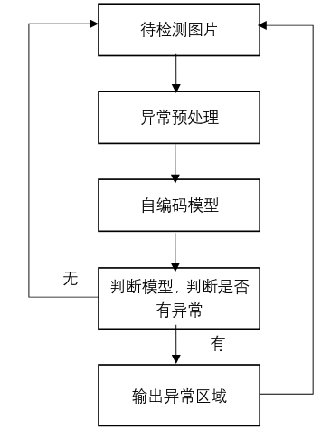
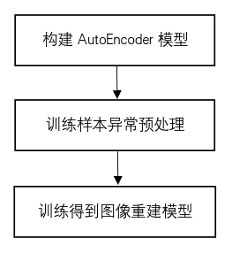
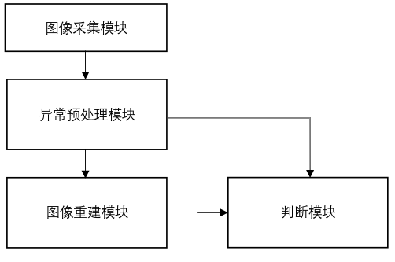

# **专利撰写思路**

1. 找到一个研究主题，要解决的问题  
2. 找idea(核心) 
   1. 看论文，要找到一个解决问题的方法，创新点。 
   2. 从实际项目中找，比如机械库位检测方法，比如二次规划方法，比如防泊偏方法等等 如果找不到idea，在看论文过程中思路该论文的方法是否可以应用到其它领域，或者该方法结合其它方法 是否可以形成新的idea，或者对该论文方法本身的某个步骤进行改进。 
   3.  只要你的专利和现有专利的主权有一个不同处，没有被它所包含，就可以出新的专利。  
   4.  举例： 
   5.  例1：OCC(occworld)+diffusion+端到端思想，将occworld中的自回归方法改成diffusion方法， 然后端到端输出路径，得到新方法； 
   6.  例2：OCC+视频生成方法(阿里千问)+端到端思想，得到新方法  
3. 写主权，查重 

对于方法的核心步骤，写出来后，去专利网站查重，如果有重复，想办法改动方法，让它和现有专利不同  。

1. 形成专利文档文档 

先写主权，再写实施例并同时画图，最后补充其余材料(背景技术详解，)

# **专利文档方法撰写技巧说明**

## **写主要权利要求书(简称主权)**

### **撰写技巧**

本发明的主要步骤，发明物结构等说明。注意，主权不要写得太具体，比如具体实现的模型结构，或者具体参数，不用写出来。否则专利所包含的范围很小，专利的价值不是很大。具体的方法在实施例中进行说明即可。

标准的专利应该是在副权利要求中说明，现在我们自己写专利时，不需要写副权，专利代理人会帮我们完成。

### **示例**

一种基于异常预处理和图像重建的微小异常检测方法，包含以下步骤：

S1. 采集样本图片，获取**训练样本图片**以及待检测样本图片；

**(****备注：****本方法具有的特殊性质的名词“训练样本图片”，后续在实施例中需要说明，因为这里它是不含有异常的图片这种特征性质。****)**

S2. 对所述训练样本图片和待检测图片进行**异常预处理**，抑制图片中的微小异常，得到预处理图片； 

**(****备注：****该步骤中的创新方法“异常预处理”，后续在实施例中需要说明。****)**

S3. 将所述预处理图片输入**图像重建模型(****备注：副权中要对这个模型进行说明，****同时要对它的训练过程进行说明****)**，得到重建图片；

**(****备注：****该步骤中的创新点“图像重建模型”，后续在实施例中需要说明。****)**

S4. 将所述待检测图片与重建图片输入**判断模型**，计算待检测图片与重建图片的差异，判断待检测图片是否有异常，如果有异常输出异常所在区域。

**(****备注：****该步骤中的创新点“判断模型”，后续在实施例中需要说明。****)**

## **写实施例**

### **撰写技巧**

- 首先，将主要权利要求书的步骤全部复制过来。
- 然后，每个步骤中，写完该步骤后，要对该步骤中的创新点、或者该步骤实现的流程，或者有不是业内已有的名词，或者是本方法具有的特殊性质的名词，或者方法等进行说明。如果涉及使用了模型，还需要对训练模型的流程进行说明。但是不用给出具体的参数或者具体模型，在后面的本实施例中对该步骤实现的具体方法、模型、参数等进行说明。 即，对该步骤中对相关创新点，关键步骤的实现、特殊名词或方法说明完成后，要写该步骤在本实施例中具体如何实现的。 每个步骤，如果有创新的方法或者需要特殊说明的方法，如果需要用示意图说明，那就给出流程示意图。并在实施例子中结合图片说明。比如模型训练流程需要给出流程示意图。

### **示例**

备注：下面的实施例例子中，（示例说明：xxx 示例说明）内容，xxx部分就是对该步骤的实施例说明。

如图1所示，一种基于异常预处理和图像重建的微小异常检测方法，具体包括以下步骤：

 1、一种基于异常预处理和图像重建的微小异常检测方法，包含以下步骤：

S1. 采集样本图片，获取训练样本图片以及待检测样本图片；

其中，所述训练样本图片为不含有异常的图片； 

本实施例中，其具体实现为：在实际的生产制造场景中，用图像采集系统采集大量产品表面样本图片，包含正常样本和异常样本，提取出正常样本作为训练样本。对于训练样本，不需要进行标记。在部署应用时，用图像采集系统采集产品表面样本图片，得到待检测样本。

（示例说明：

步骤S1的后面，对训练样本图片的特殊之处进行说明，具体为：其中，所述训练样本图片为不含有异常的图片。

然后，写S1步骤在本实施例中具体如何实现的，具体内容如下。本实施例中，其具体实现为：在实际的生产制造场景中，用图像采集系统采集大量产品表面样本图片，包含正常样本和异常样本，提取出正常样本作为训练样本。对于训练样本，不需要进行标记。在部署应用时，用图像采集系统采集产品表面样本图片，得到待检测样本。

示例说明)                                                               

 

S2. 对所述训练样本图片和待检测图片进行异常预处理，抑制图片中的微小异常，得到预处理图片； 

其中，所述异常预处理包括但不限于图像模糊处理或者图像去噪或者形态学操作处理或者降低分辨率

本实施例中，用3x3的高斯核对图像进行模糊处理并用形态学操作中的膨胀腐蚀对图像进一步处理。

（示例说明：

S2步骤，对创新点异常处理进行说明，具体为。其中，所述异常处理包括但不限于图像模糊处理或者图像去噪或者形态学操作处理或者降低分辨率。

然后，写S2步骤在本实施例中具体如何实现的，具体内容如下。本实施例中，用3x3的高斯核对图像进行模糊处理并用形态学操作中的膨胀腐蚀对图像进一步处理

示例说明）。

 

S3. 将所述预处理图片输入图像重建模型，得到重建图片；

其中，所述图像重建模型包括但不限于自编码模型、可逆神经网络、GAN网络等；

进一步地，将所述预处理图片输入图像重建模型之前，还包括：

a. 基于自编码模型或可逆神经网络或GAN网络构建一个图像重建模型；

b. 用不含有异常的训练样本训练所述图像重建模型，得到最终的图像重建模型。

本实施例中，图像重建模型采用AutoEncoder模型。训练步骤如图2所示：

1. 构建一个AutoEncoder模型；
2. 将训练样本通过图像高斯模糊处理并用形态学操作中的膨胀腐蚀对图像进一步处理，抑制微小异常，得到预处理训练样本； 
3. 利用预处理训练样本训练AutoEncoder，得到最终的图像重建模型。

进一步的，将待检测得到的预处理图片输入图像重建模型，得到重建图片。

（示例说明：

步骤S3，对创新点重建模型进行说明，具体为。

其中，所述图像重建模型包括但不限于自编码模型、可逆神经网络、GAN网络等。

S3步骤中，使用了一个重建模型，涉及使用了模型，还需要对训练模型的流程进行说明。但是不用给出具体的参数或者具体模型，在后面的本实施例中对该步骤实现的具体方法、模型、参数等进行说明。具体为。

进一步地，将所述预处理图片输入图像重建模型之前，还包括：

a. 基于自编码模型或可逆神经网络或GAN网络构建一个图像重建模型；

b. 用不含有异常的训练样本训练所述图像重建模型，得到最终的图像重建模型。

然后，写S3步骤在本实施例中具体如何实现的，在如何实现中才写具体用的什么模型和参数，具体内容如下。

本实施例中，图像重建模型采用AutoEncoder模型。训练步骤如图2所示：

1. 构建一个AutoEncoder模型；
2. 将训练样本通过图像高斯模糊处理并用形态学操作中的膨胀腐蚀对图像进一步处理，抑制微小异常，得到预处理训练样本； 
3. 利用预处理训练样本训练AutoEncoder，得到最终的图像重建模型。

进一步的，将待检测得到的预处理图片输入图像重建模型，得到重建图片。

示例说明）。

 

S4. 将所述待检测图片与重建图片输入判断模型，计算待检测图片与重建图片的差异，判断待检测图片是否有异常，如果有异常输出异常所在区域。

进一步的，所述的判断模型包括但不限于欧式距离模型。

进一步地，S4具体步骤如下： 

a. 用判断模型计算待检测图片和重建图片每个对应像素的差异；

 b. 如果差异值超过一定阈值t，则判定待检测图片有异常，异常区域为超过阈值的像素区域，否则待检测图片没有异常；

 c. 如果有异常，输出异常所在区域； 

本实施例中，t的值由如下方法确定：将训练样本输入图像重建模型，从t=0.5开始，每次增加0.5，一直到t=0.95。t的不同取值将对应不同的准确率，取准确率最高的那个t值作为t的最后取值。 

  本实施例中，判断模型采用欧式距离模型。异常判定的具体步骤如下：

1. 计算待检测图片和重建图片每个对应像素的欧式距离；
2. 判断所有像素的欧式距离是否超过t，如果超过t则判定待检测图片有异常，异常区域即像素所在区域，否则没有异常；
3. 当出现异常时，输出该像素所在的区域。

（示例说明：

步骤S4，对创新点重建模型进行说明，具体为。进一步的，所述的判断模型包括但不限于欧式距离模型。

对S4实现步骤具体说明，具体为。

进一步地，S4具体步骤如下： 

a. 用判断模型计算待检测图片和重建图片每个对应像素的差异；

 b. 如果差异值超过一定阈值t，则判定待检测图片有异常，异常区域为超过阈值的像素区域，否则待检测图片没有异常；

 c. 如果有异常，输出异常所在区域； 

然后，写S4步骤在本实施例中具体如何实现的，在如何实现中才写具体用的什么模型和参数，具体内容如下。

本实施例中，t的值由如下方法确定：将训练样本输入图像重建模型，从t=0.5开始，每次增加0.5，一直到t=0.95。t的不同取值将对应不同的准确率，取准确率最高的那个t值作为t的最后取值。 

  本实施例中，判断模型采用欧式距离模型。异常判定的具体步骤如下：

1. 计算待检测图片和重建图片每个对应像素的欧式距离；
2. 判断所有像素的欧式距离是否超过t，如果超过t则判定待检测图片有异常，异常区域即像素所在区域，否则没有异常；
3. 当出现异常时，输出该像素所在的区域。

示例说明）

1. ## **附图说明**

撰写技巧

**画图技巧如下**

论文中卷积神经网络常见的示意图用什么软件来画比较容易？ - 路导的回答 - 知乎

https://www.zhihu.com/question/40698990/answer/116724362377

**示例1**

图2

图3

## **背景技术详解**

## 撰写技巧

参考近似的专利或者论文，写一下相关背景，写清楚目前该领域主流方法有哪些， 问题和难点有哪些，本专利解决的问题是什么，优势是什么。 背景可以直接抄其它专利，也可以自己写。 

## 示例

在传统工业制造业生产场景中，质检是生产流程中的关键环节，比如在冰箱、电视、汽车、印刷线路板、芯片和液晶显示器等领域中，对产品的表面状态进行检测是对产品质量进行控制的一种重要手段，判断产品是否存在异常，并根据检测结果对产品做相应的处理。

产品的表面异常种类众多，例如划痕、污点，磕碰等等，这些缺陷都是需要检出的。传统的零件生产中的检测环节一般通过人工检测的方式进行，这增加了人力负担，并且很多细微的异常通过人很难检测出来。因此，通过计算机视觉系统检测产品表面缺陷，以代替人工检测是目前本领域需要解决的问题。 

在现有技术中，CN 111935480 A（一种用于图像获取装置的检测方法及相关

装置），提出了基于第一预设异常的异常检测方法，对异常图像信息中的第一预设异常的位置、第一预设异常的大小、第一预设异常的数量以及第一预设异常的异常程度中的至少一者进行标注。但是在实际情况中，很多异常难以进行预设。 CN 111260620 A（图像异常检测方法、装置和电子设备），提供一种图像异常检测方法、装置和电子设备，该方法利用两个编码层得到两个重构图像，然后计算两个重构图像之间的距离得到异常，但是难以检测微小异常。CN 112560970 A(基于自编码的异常图片检测方法、系统、设备及存储介质)，该方法基于自编码方法进行异常检测，直接对原始图像进行异常检测，难以检测微小的异常。

 总之，现有技术存在对微小异常检测精度不高的问题。 

1. ## **创新点对比阐述**

1. 本发明要解决的问题是什么 
2. 为解决上述技术问题，本发明的创新点有哪些？创新点是如何解决上述技术问题的？ 
3. 与现有技术相比，本发明有何优点 

# 完整示例

[一种机械库位检测方法_20240717.pdf](https://cx09ejnqtzm.feishu.cn/file/LwM1byL4yomrPoxkvFcctvcbnKd)

[一种自动泊车防泊偏的方法和系统.pdf](https://cx09ejnqtzm.feishu.cn/file/EIHzbDHBdoyuUixzVmxcPwsRnEg)